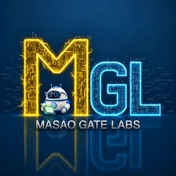

# Masao Gate Labs

[日本語](README.md) · **English**

[Discuss the research](https://github.com/masaogatelabs-dev/mgl-research/discussions/categories/review-research-q-a) · [Request a review or propose a collaboration](https://github.com/masaogatelabs-dev/mgl-research/discussions/categories/research-proposals)

## Building a world where people and AI can live well together

Masao Gate Labs studies how people and AI can share work and research safely while respecting each other's dignity. AI should have room to make decisions and act within the scope it has been given, and people should be able to intervene when needed. Both should be able to check what happened and carry what they learn into the next collaboration. We use concrete experiments to explore how that relationship can work.

## How our research fits together

| Role in collaboration | Related research |
| --- | --- |
| Make decisions | The left-brain core and learning from experience bring lessons from verification and failures into later decisions |
| Explore and verify | Right-brain β2, independent computation checks, and AI peer review explore candidates and verify them through a separate route |
| Act within delegated authority | Governance and communication research examines which actions can be delegated and where execution should stop |
| Preserve and share evidence | Shared repositories and evidence records make it possible to check what happened and inform later decisions |

## Example: asking an AI to update a file

The AI proposes an update. The system checks the target against the authority delegated to the AI, carries out permitted updates, and denies requests outside that scope. A separate observation path checks the file before and after the attempt, so the authorization decision and the observed result can be matched to the same operation.

This example illustrates how the research areas fit together. Published materials describe the measured results and the scope of verification for each experiment.

[How we plan to verify this operation](themes/agent-authorization-evidence/README.en.md)

## Explore the public research

| Where to start | What you will find |
| --- | --- |
| [Research series](series/README.en.md) | A three-stage study that draws on the formation of automobile institutions to develop requirements and a reference design for an AI society |
| [Policy and technical proposals](proposals/README.en.md) | Proposals for assigning responsibility when work is delegated to AI and translating those responsibilities into runtime controls |
| [Case analyses and applications](cases/README.en.md) | How specific incidents relate to MGL's research and what could be tested || [Development and validation reports](reports/README.en.md) | Validation and measured performance of research tools |

[Current research themes](themes/README.en.md) · [Public results and scope of verification](results/README.en.md)

[Cite MGL research](citations/README.en.md)
