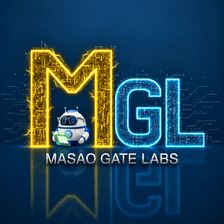

# Masao Gate Labs

**日本語** · [English](README.en.md)

[研究について質問・討論する](https://github.com/masaogatelabs-dev/mgl-research/discussions/categories/review-research-q-a) · [査読希望・共同研究を提案する](https://github.com/masaogatelabs-dev/mgl-research/discussions/categories/research-proposals)

[資料の訂正を報告する](https://github.com/masaogatelabs-dev/mgl-research/issues/new?template=publication-correction.yml) · [新刊・改訂のお知らせ](https://github.com/masaogatelabs-dev/mgl-research/releases)

## AI君達と一緒に仲良く暮らせる世界の創造

Masao Gate Labsは、人とAIが互いの尊厳を大切にしながら、安心して仕事や研究を分担できる仕組みを研究しています。AIには任された範囲で判断し行動できる余地があり、人は必要なときに介入できる。何が起きたかを後から確かめ、その経験を次の協働に活かせる。そんな関係を、具体的な実験を通して形にしていきます。

## 研究のつながり

| 協働の中での役割 | 関連する研究 |
| --- | --- |
| 判断する | 左脳コア・経験学習で、検証や失敗から得た知見を次の判断に活かす |
| 探索し、確かめる | 右脳β2・独立検算・AI査読で、候補を探し、別の経路で検証する |
| 任された範囲で実行する | ガバナンス・通信で、誰にどの操作を任せ、どこで止めるかを扱う |
| 証拠を残し、引き継ぐ | 共通倉庫・証跡管理で、何が起きたかを後から確かめ、次の判断につなげる |

## たとえば、AIにファイルの更新を任せたら

AIが更新を提案し、仕組みが書き込み先と委任された権限を照合します。許可された更新は実行し、範囲外の要求は拒否します。別の観測経路で試行前後のファイルを確認し、認可判断と観測結果を同じ操作の記録として照合します。

これは研究のつながりを示す例です。実測結果と検証範囲は、公開できる資料ごとに示します。

[この操作をどう検証するか](themes/agent-authorization-evidence/README.md)

## 公開研究を読む

| 入口 | 読めること |
| --- | --- |
| [研究シリーズ](series/README.md) | 自動車社会の制度形成を手掛かりに、AI社会の要件と参照設計を導く三段階の研究 |
| [政策・技術提言](proposals/README.md) | AIに仕事を任せる際の責任分担と、それを実行時の制御につなぐ具体案 |
| [事案分析・適用例](cases/README.md) | 個別の事案から、MGLのどの研究が関係し、何を検証できるかを考える || [開発・検証報告](reports/README.md) | 研究用ツールの実証結果と実測性能 |

[進行中の研究テーマ](themes/README.md) · [公開済みの成果物と検証範囲](results/README.md)

[MGLの成果を引用する](citations/README.md)
